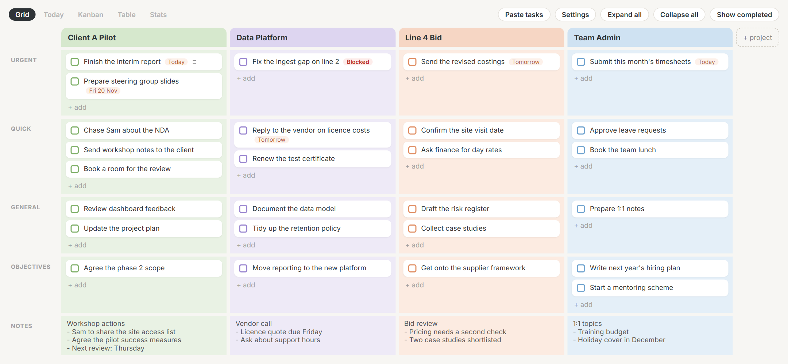
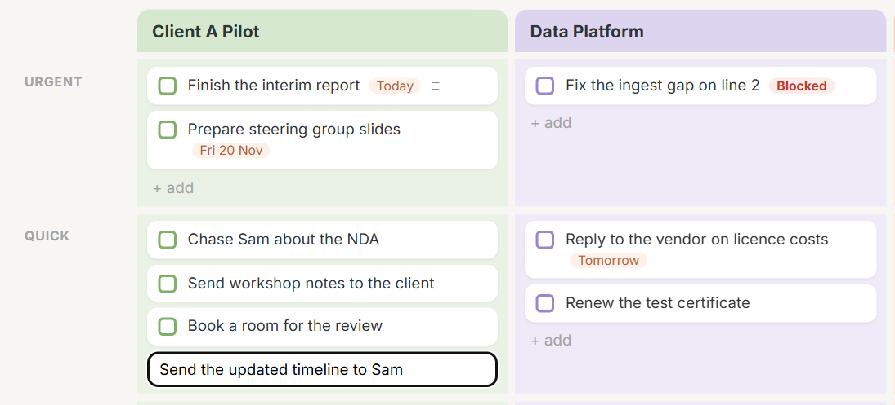
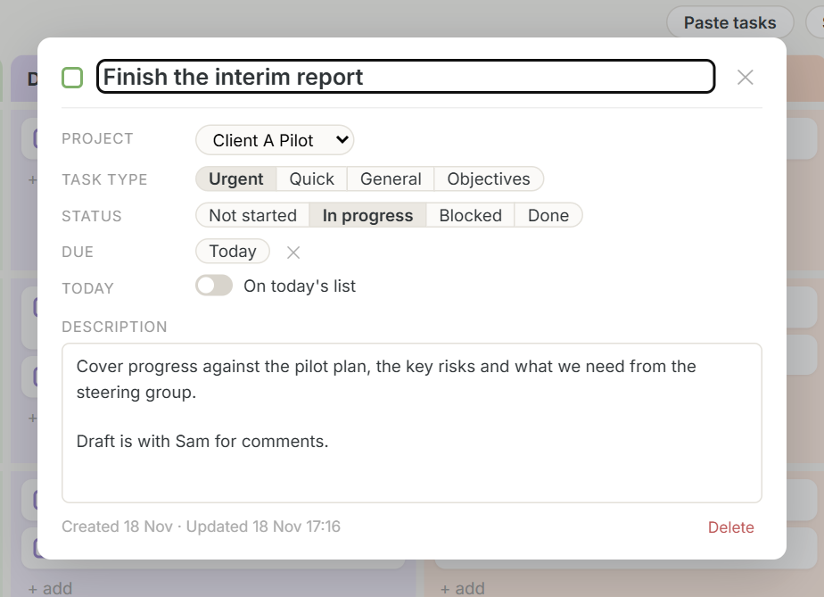
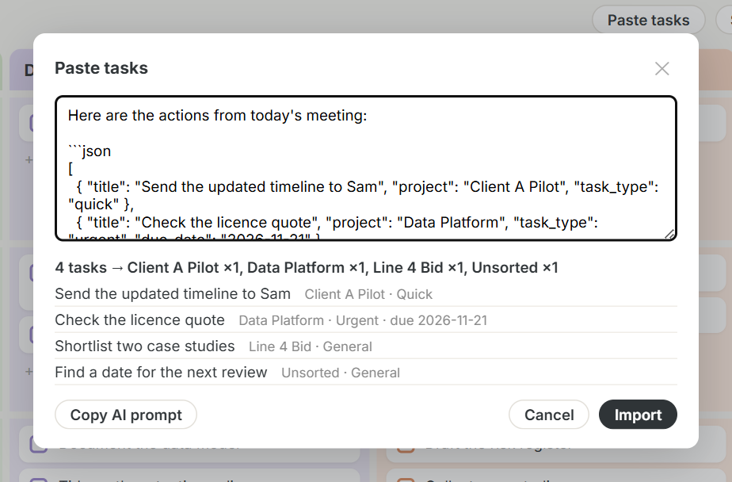

# ToDoApp

**A minimal, project-based to-do board for people juggling several projects at once.**



If your week looks like three client projects, a bid, some team admin and a handful of longer-term goals, ToDoApp puts all of it on one screen: one **column per project**, one **row per kind of task**. You capture a task by typing a line and pressing Enter, and you tick it off with one click. That's it. No forms, no required fields, no tags to maintain.

I built this to replace a very useful OneNote notebook table that worked better for me than every other "proper" task tool tried. It suits consultants, engineers, researchers and anyone else whose work is organised by project.


## Why you might like it

- **Fast capture.** Every cell has a "+ add" line. Type, press Enter, keep typing. Dates, descriptions and status are optional extras you can add later, or never. For me this was the critical goal, to minimise the time spent maintaining the task board. 
- **Everything at a glance.** All projects, all task types, one page. No cell ever scrolls inside itself, so nothing hides; when the board gets long, the page scrolls, which is your nudge to tidy up.
- **Your data stays yours.** Every task is a small JSON file in a folder you choose. The app runs on your own machine, listens only on `127.0.0.1`, and makes **no outbound network calls at all**: no accounts, no cloud, no analytics, no update checks, not even web fonts.
- **Plays well with AI.** Paste an AI assistant's meeting summary task list (Copilot, ChatGPT, Claude and so on) into the **Paste tasks** box, or have a tool drop a file into the `inbox/` folder, and the tasks appear on the board. Handy for turning meeting notes into actions (you will just need to prompt the models to output the correct format)
- **Works on a locked-down work laptop.** The Windows version is a single `.exe` that needs no installer and no admin rights.

## What it does today

The **Grid** and **Today** views are built and usable day to day.

- **Projects as columns**, each with its own pastel colour. Add, rename, reorder, recolour and close projects from the right-click menu on a project's name. Closed projects can be reopened from Settings.
- **Task types as rows:** Urgent, Quick, General and Objectives, plus a free-text **Notes** box per project for meeting scribbles.
- **Tick to complete.** Completed tasks hide by default; "Show completed" brings them back.
- **Click a task** to open it and add a description, a due date (with a date picker), a status (Not started, In progress, Blocked, Done) or to move it.
- **Drag and drop** tasks between cells, or right-click a task to move it, change its status or delete it (with Undo).
- **Collapse** a project or a row you don't need right now; "Expand all" brings everything back.
- **Today.** The **Today** tab is one calm list of the tasks you've picked for the day, under the date, with a **Done today** section at the bottom. Tick tasks there, drag a row (or press **Alt+Up/Down** on it) to reorder, and use **×** to take a task off today's list; that only unpins it, the task stays on the Grid.
- **Plan today.** The **Plan today** button switches the Grid to picking mode: click a task card to add or remove it from today, then press **Done planning** (or **Esc**) to land on Today. Tick boxes still tick while you pick.
- **Pin from the Grid.** Hover a card and click its pin to add it to today in one click. Pinned cards show in bold.
- **Due dates you can spot.** Overdue dates are bold with an orange outline, dates due today are normal, and future dates are quiet grey text.
- **Paste tasks** and the **inbox folder** for bulk import, with a preview before anything is added. Tasks for unknown projects go to **Unsorted**, so nothing is lost.
- **Settings:** text size, data folder, start when you log in (Windows), reopen closed projects, empty the trash.
- **Live updates.** Edit a task file in another program, or drop one in the inbox, and the board updates by itself.

The **Kanban, Table and Stats** buttons in the top bar are placeholders for later stages and are greyed out for now.

## Getting started

There are no ready-made downloads yet, so you build ToDoApp from this repository. That takes about five minutes and is the same on every machine.

### What you need

- **Python 3.12 or newer** (3.13 is what it's tested on): <https://www.python.org/downloads/>
- **Node.js 22 LTS or newer**, only to build the user interface once: <https://nodejs.org/>
- **Git**, or use GitHub's **Code → Download ZIP** button and unzip it.

Neither Python nor Node needs admin rights if you install them "for me only".

### Windows: build the app (recommended)

Open PowerShell in the folder where you want ToDoApp to live, then:

```powershell
git clone https://github.com/NPietrow/ToDoApp.git ToDoApp
cd ToDoApp
py -3.13 -m venv .venv
powershell -ExecutionPolicy Bypass -File scripts/build-exe.ps1
```

(Use `py -3.12` instead if that's the Python you installed. `-ExecutionPolicy Bypass` applies to that one command only; it doesn't change any system setting.)

After a minute or two you'll have **`dist\ToDoApp.exe`**. Copy it anywhere you like, for example into a `Tools` folder in your user profile, and double-click it:

- The board opens in its own window (using Edge or Chrome in "app" mode, so there's no address bar).
- A green tick icon appears in the system tray. Right-click it for **Open** and **Quit**. If you don't see it, look under the **^** arrow next to the clock.
- Starting the exe again while it's running just brings the window back.
- To have it start automatically, tick **Start when I log in** in Settings.

### Any system: run from source (Windows, macOS, Linux)

From the repository folder:

**Windows (PowerShell)**

```powershell
py -3.13 -m venv .venv
.venv\Scripts\python -m pip install -c server/requirements.txt -e server
npm --prefix web ci
npm --prefix web run build
.venv\Scripts\python -m todoapp
```

**macOS / Linux**

```bash
python3 -m venv .venv
.venv/bin/python -m pip install -c server/requirements.txt -e server
npm --prefix web ci
npm --prefix web run build
.venv/bin/python -m todoapp
```

Your browser opens at <http://127.0.0.1:8765/>. Stop it with **Ctrl+C** in the terminal. Next time, only the last line is needed.

> macOS and Linux aren't part of the regular testing yet. They should work from source (the app is a plain web page served from your machine), but please open an issue if something doesn't.

## Using it

1. **Create your first project.** On the empty board, click **Create your first project** and give it a name. Add more with **+ project** after the last column; right-click a project's name for more options.
2. **Capture tasks.** Click **+ add** in any cell, type, press **Enter**. The box stays open for the next one. **Escape** closes it.

   

3. **Tick tasks off** with the checkbox.
4. **Add detail when you have time.** Click a task to open it: description, due date, status, task type, project.

   

5. **Keep notes** in each project's Notes box. It saves as you type.
6. **Plan your day.** Click **Plan today**, click the tasks you want to do today, then **Done planning**. The **Today** tab shows just those, in the order you choose.

### Getting tasks in from an AI assistant

1. In ToDoApp, click **Paste tasks**, then **Copy AI prompt**. That copies a ready-made prompt that already lists your project names.
2. Paste the prompt into your AI assistant, followed by your meeting notes or transcript.
3. Copy the assistant's whole reply, paste it into the **Paste tasks** box, check the preview and click **Import**.



The assistant's reply can include chat and code fences; ToDoApp finds the tasks inside it. If a tool can write files instead, have it save a `.json` file into the `inbox/` folder of your data folder. The format and a sample prompt are in [docs/ai-intake/README.md](docs/ai-intake/README.md), and the formal schema in [docs/ai-intake/intake.schema.json](docs/ai-intake/intake.schema.json).

## Where your data lives

Everything is plain files you can back up, sync or inspect.

| What | Where |
|---|---|
| **Data folder** (your tasks) | `Documents/ToDoApp` by default. Change it in Settings; nothing is moved, the board just shows what's in the new folder. |
| Tasks | `tasks/`: one JSON file per task |
| Projects | `projects.json` |
| Notes | `notes/<project id>.txt`: plain text |
| Planning log | `log/planning.json`: the days you used Plan today |
| Inbox | `inbox/`: drop task files here; imported files move to `inbox/processed/` |
| Deleted tasks | `.trash/tasks/`, until you empty the trash in Settings |
| **Settings** | Windows: `%LOCALAPPDATA%\ToDoApp\settings.json` · macOS: `~/Library/Application Support/ToDoApp/settings.json` · Linux: `~/.config/ToDoApp/settings.json` |
| Logs (Windows exe only) | `%LOCALAPPDATA%\ToDoApp\Logs\todoapp.log` |

You can keep the data folder in a synced folder such as OneDrive or Dropbox. The app ignores the temporary files sync tools create. Keep **separate data folders for work and personal use**: one install per machine, each with its own folder.

Files the app can't read are listed under **File problems** in the top bar. They're never changed or deleted, so a bad hand edit or a sync conflict never costs you a task.

## Options

| Option | What it does |
|---|---|
| `--data-dir <folder>` | Use another data folder for this run only (not saved) |
| `--port <number>` | Use another port for this run only (default 8765) |
| `--config <file>` | Use another settings file |
| `--no-browser` | Don't open a browser window on start |
| `TODOAPP_DATA_DIR`, `TODOAPP_PORT` | Environment-variable versions of `--data-dir` and `--port` |
| `TODOAPP_WATCH_POLL=2` | Check the data folder for outside changes every 2 seconds instead of relying on change notifications. Use it for folders where notifications don't arrive, such as one mounted into a container. |

Trying it out without touching your real tasks:

```powershell
.venv\Scripts\python -m todoapp --data-dir .scratch-data --config .scratch-data\settings.json --port 8790
```

The same flags work on the exe: `ToDoApp.exe --data-dir … --port …`.

## Troubleshooting

- **The port is in use.** Another program is already using port 8765. Start with `--port 8790` (or any free port), or change `"port"` in `settings.json` to make it permanent.
- **The window shows "ToDoApp isn't running".** The app was quit or crashed. Start it again; the window reconnects by itself.
- **A task file I dropped in `inbox/` didn't appear.** Check **File problems** in the top bar. Inbox files must be valid JSON; for messier AI output, use the **Paste tasks** box, which is more forgiving.
- **Windows SmartScreen warns about the exe.** That happens because the exe you built isn't code-signed. Choose **More info → Run anyway**, or run from source instead.

## Security and privacy

- The server listens on `127.0.0.1` only, so it's unreachable from other machines.
- It checks the `Host` header on every request and the `Origin` header on every change, so other websites open in your browser can't read or change your tasks.
- The app makes no outbound connections: no telemetry, no update checks, no CDNs; the Inter font is bundled.
- Writes are atomic (write to a temporary file, then rename), so a crash can't leave half a task file behind.

## For developers

The server is Python (FastAPI, Uvicorn, Pydantic, watchdog). The UI is Svelte 5 and TypeScript built with Vite into static files that the server serves, so Node isn't needed at run time.

```text
server/todoapp/        Python server: API, file storage, inbox, folder watcher, Windows launcher
server/tests/          pytest
web/src/               Svelte UI
web/tests/             Vitest unit tests
web/e2e/               Playwright end-to-end tests (run on Microsoft Edge)
docs/ai-intake/        The task intake format for AI tools
scripts/build-exe.ps1  Builds dist/ToDoApp.exe with PyInstaller
```

Set up with the dev extras (add `,windows` on Windows for the tray and launcher):

```powershell
py -3.13 -m venv .venv
.venv\Scripts\python -m pip install -c server/requirements.txt -e "server[dev,windows]"
npm --prefix web ci
```

Then:

```powershell
.venv\Scripts\python -m pytest server -q   # server tests
npm --prefix web run test                  # UI unit tests
npm --prefix web run check                 # svelte-check and TypeScript
npm --prefix web run build                 # build the UI (needed by the next line)
npm --prefix web run e2e                   # end-to-end tests on Edge, own server on port 8799
```

Later stages are planned to add the Kanban, Table and Stats views. The code was written with Claude Code, from a design and decisions made by the author.

## Licence

[MIT](LICENSE). Use it, change it, share it.
